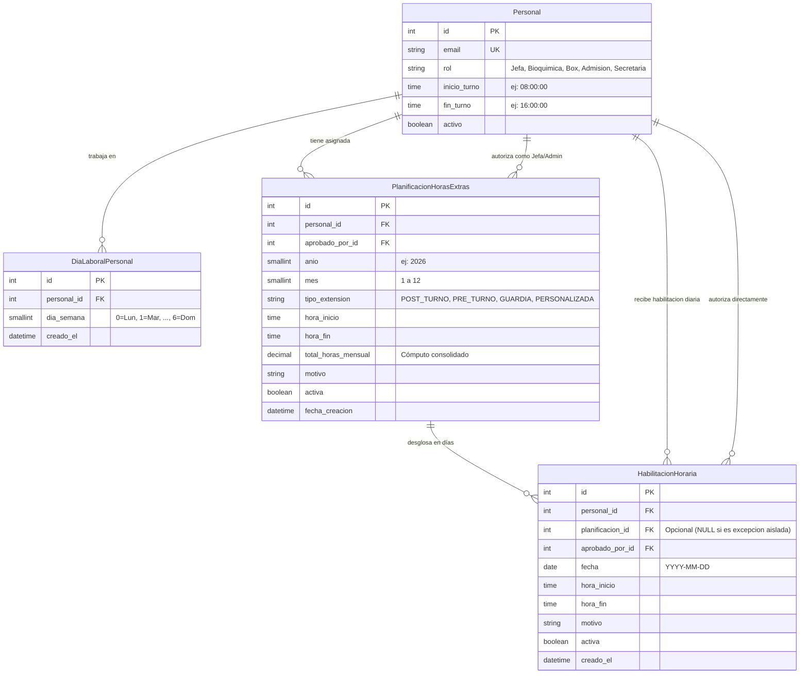
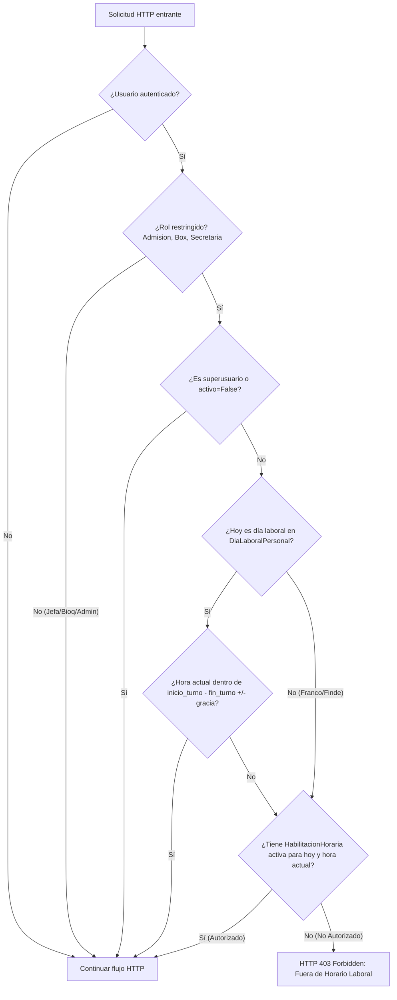

# Arquitectura del Módulo de Habilitación Horaria y Horas Extras

## 1. Visión General y Objetivos del Módulo

El módulo de **Habilitación Horaria y Horas Extras** gestiona el control de acceso y la autorización de jornadas extraordinarias para el personal del laboratorio clínico (roles operativos: `Admision`, `Box`, `Secretaria`).

Sus objetivos fundamentales son:
1. **Control de Acceso Temporal (RBAC Asistencial):** Garantizar que el personal solo pueda autenticarse e interactuar con el sistema durante su horario asignado o dentro de franjas extraordinarias explícitamente autorizadas por la Jefa de Laboratorio o Administradores.
2. **Planificación Mensual y Detalle Diario (Patrón Master-Detail / Estrategia A):** Permitir autorizaciones masivas para un mes completo calculando el acumulado mensual de horas extras para liquidación hospitalaria, pero conservando la granularidad diaria para permitir exclusiones individuales (francos pedidos, licencias o ausencias no trabajadas).
3. **Normalización Relacional (3NF):** Eliminar listas concatenadas de días de trabajo mediante tablas intermedias normalizadas (`DiaLaboralPersonal`).
4. **Separación de Responsabilidades (SRP / Clean Architecture):** Aislar la lógica de dominio de turnos en `app/models/shifts.py` y `app/schemas/shifts.py`, evitando sobrecargar el archivo nuclear `user.py`.

---

## 2. Diagrama Entidad-Relación (Base de Datos Relacional 3NF)



---

## 3. Componentes de la Arquitectura Backend

### 3.1 Modelos de Dominio

#### A. Días Laborables Normalizados (`app/models/user.py`)
- **`DiaSemanaChoices`:** Enumeración estándar de lunes (0) a domingo (6).
- **`DiaLaboralPersonal`:** Tabla relacional `sgtp_personal_dias_laborales` con restricción `UniqueConstraint(fields=['personal', 'dia_semana'])`.
- Propiedad asistida en `Personal`:
  - `dias_laborales_indices`: Retorna lista ordenada de enteros (ej. `[0, 1, 2, 3, 4]`).

#### B. Módulo Dedicado de Turnos (`app/models/shifts.py`)
- **`TipoExtensionChoices`:** Opciones de extensión horaria:
  - `POST_TURNO`: Extensión inmediatamente posterior al fin del turno regular.
  - `PRE_TURNO`: Guardia o extensión anticipada antes del inicio del turno regular.
  - `GUARDIA`: Asignación en días no laborables o fines de semana (Sábados/Domingos).
  - `PERSONALIZADA`: Franja horaria arbitraria.
- **`PlanificacionHorasExtras` (`sgtp_planificacion_horas_extras`):**
  - Entidad maestra que consolida la orden mensual.
  - Restricción única: `UniqueConstraint(fields=['personal', 'anio', 'mes'])` para evitar planes duplicados en el mismo período.
  - Campo analítico `total_horas_mensual` derivado de la cantidad de días efectivos por la duración diaria.
  - Registrado en auditoría con `auditlog.register(PlanificacionHorasExtras)`.
- **`HabilitacionHoraria` (`sgtp_habilitacion_horaria`):**
  - Entidad de detalle diario que representa cada fecha autorizada.
  - Cuenta con clave foránea opcional `planificacion = ForeignKey(PlanificacionHorasExtras, null=True, on_delete=CASCADE)`.
  - Validación de negocio en `clean()`:
    - Comprueba que `hora_inicio < hora_fin`.
    - En días laborales contractuales del personal, rechaza cualquier franja que se solape con el horario ordinario (`inicio_turno` a `fin_turno`), garantizando consistencia asistencial.
  - Registrado en auditoría con `auditlog.register(HabilitacionHoraria)`.

---

### 3.2 Esquemas y Serializadores (`app/schemas/shifts.py`)

1. **`HabilitacionHorariaSerializer`:**
   - Serializa y valida habilitaciones individuales diarias.
   - Expone datos contextuales del aprobador (`aprobado_por_nombre`, `aprobado_por_rol`) para trazabilidad forense.

2. **`PlanificacionHorasExtrasSerializer`:**
   - Acepta la lista de fechas seleccionadas por la Jefa: `fechas_seleccionadas = ListField(child=DateField())`.
   - **Método `create()` atómico:**
     1. Si existía una planificación previa para ese mismo personal, año y mes, la elimina limpiamente junto con sus habilitaciones diarias asociadas (cascada relacional).
     2. Calcula la duración en horas por jornada: `(fin - inicio) / 3600`.
     3. Computa `total_horas_mensual = len(fechas_seleccionadas) * duracion_horas`.
     4. Crea la cabecera `PlanificacionHorasExtras`.
     5. Ejecuta `bulk_create` de todas las instancias de `HabilitacionHoraria` correspondientes a las fechas activas vinculadas a dicha cabecera.

---

### 3.3 Endpoints REST y Controladores (`app/api/endpoints/users.py`)

| Método | Endpoint | Permisos | Descripción |
| :--- | :--- | :--- | :--- |
| `GET` | `/api/v1/users/planificaciones-horas-extras/` | `IsAuthenticated` (Jefa/Admin) | Lista planificaciones mensuales con filtros por `personal`, `anio`, `mes`. |
| `POST` | `/api/v1/users/planificaciones-horas-extras/` | `IsAuthenticated` (Jefa/Admin) | Crea la planificación mensual y desglosa en bloque las habilitaciones diarias. |
| `GET` | `/api/v1/users/habilitaciones-horarias/` | `IsAuthenticated` | Consulta habilitaciones diarias con filtros por `personal`, `fecha`, `activa`. |
| `POST` | `/api/v1/users/habilitaciones-horarias/` | `IsAuthenticated` (Jefa/Admin) | Crea una excepción puntual de un solo día. |
| `DELETE` | `/api/v1/users/habilitaciones-horarias/{id}/` | `IsAuthenticated` (Jefa/Admin) | Desactiva (soft-delete lógico) una habilitación puntual. |
| `PATCH` | `/api/v1/users/habilitaciones-horarias/{id}/reactivar/` | `IsAuthenticated` (Jefa/Admin) | Reactiva una habilitación revocada. |

---

### 3.4 Middleware de Seguridad (`app/middlewares/security.py`)

El componente `ShiftScheduleRestrictionMiddleware` intercepta todas las solicitudes HTTP autenticadas y aplica el siguiente flujo de autorización temporal:



#### Ventaja de Rendimiento de la Estrategia A:
La consulta del middleware evalúa directamente la tabla indexada `HabilitacionHoraria`:
```python
HabilitacionHoraria.objects.filter(
    personal=user,
    fecha=now_date,
    activa=True,
    hora_inicio__lte=now_time_with_grace_end,
    hora_fin__gte=now_time_with_grace_start
).exists()
```
Esta consulta se resuelve en **menos de 1 milisegundo**, independientemente de si la habilitación proviene de una planificación mensual o de una excepción puntual.

---

## 4. Trazabilidad y Auditoría (Auditlog)

Tanto `PlanificacionHorasExtras` como `HabilitacionHoraria` están registradas en Django Auditlog:
- Se registra automáticamente el usuario que ejecutó la autorización (`aprobado_por`).
- Se auditan altas, modificaciones de horarios y bajas lógicas.
- Los logs son inalterables y quedan a disposición para auditorías médicas, inspecciones laborales o peritajes.
